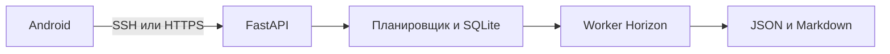

# Архитектура и API

## Компоненты

- **Android** — Kotlin, Compose и Material 3. `ManagerModel` держит состояние в Flow, транспорт и файловые операции выполняются через корутины вне UI. `Vault` шифрует профиль SSH и bearer-токен ключом Android Keystore. Room хранит полученные страницы дайджестов, локальные отметки и журнал. Для плавающей панели на Android 12+ Compose размывает фон в пределах панели. На более старых версиях используется тот же цветовой слой без GPU-размытия. Служба Android ждёт маркер следующего дайджеста в отдельном SSH-сеансе или по HTTPS. WorkManager восстанавливает пропущенные уведомления через фоновую проверку того же маркера.
- **Установщик** — Android отправляет четыре файла по SFTP во временную папку пользователя. После явного подтверждения проверенная SSH-сессия вызывает ограниченный bootstrap через root или sudo. Работа передаётся отдельному заданию systemd. Состояние установки и её этапы сохраняются в `/var/lib/horizon-manager-install/`. Установка зависимостей Horizon и сборка Python-окружения выполняются непривилегированным служебным пользователем.
- **Агент** — FastAPI/Pydantic, SQLite и планировщик с постоянным состоянием. Служба получает динамический UID через systemd, конфигурацию и файлы сохраняет в `/var/lib/horizon-manager-runtime/`. Секреты и история конфигурации хранятся в приватной SQLite, их значения не возвращаются Android через API. Bearer-токен выдаётся сервису через systemd LoadCredential. 
- **Движок** — отдельный worker с закреплённой средой Horizon. Планировщик и ручной запуск используют одну очередь. Остановка завершает группу процессов задания. Состояние активного исполнения после перезапуска меняется на «прервано». Прерванный запрос AI автоматически не повторяется. Конфигурация изменяется транзакционно с проверкой номера ревизии; перед изменением сохраняется предыдущая версия.



## Транспорт

В режиме SSH Android создаёт канал `direct-tcpip` до `127.0.0.1:18777` внутри проверенной SSH-сессии. На телефоне отдельный порт не открывается. Приложение проверяет SHA-256 отпечаток SSH до аутентификации. Смену ключа нужно подтвердить в настройках SSH после независимой сверки. Для HTTPS проверка имени и доверия сертификату использует платформу Android, перенаправления не допускаются, токен не отправляется на новый домен.

Для собственной установки reverse proxy следует проксировать только версионированный API и сохранить заголовок Authorization. Пример для существующего Caddy с доменом и TLS:

```caddyfile
horizon.example.org {
    handle /v1/* {
        reverse_proxy 127.0.0.1:18777
    }
    handle {
        respond 404
    }
}
```

Настройка обратного прокси не входит в основную установку. Она выполняется владельцем своей инфраструктуры только при выборе HTTPS. Менеджер штатно работает через SSH без домена.

## API v1

В каждый вызов включается `Authorization: Bearer <token>`. Ошибки возвращаются как `{"detail":{"code":"CONFIG_CHANGED"}}`. Поля `fields` содержат пути проблемных полей. Значения входных данных в ответах об ошибке опускаются.

- `GET /v1/health`, `GET /v1/status` — версия, ревизия Horizon, ресурсы и ближайший запуск.
- `GET /v1/upstream` — проверка commit GitHub. HEAD upstream не устанавливается автоматически.
- `GET /v1/schema` — схемы config и профилей, список провайдеров и источников.
- `GET /v1/config`, `PUT /v1/config` — чтение и атомарное применение `revision`, `config`, `profiles`, опционального объекта изменений `secrets`. Значение `null` удаляет секрет.
- `GET /v1/ai/catalog/{router}` — каталог OpenRouter или UnoRouter с ключом из базы агента. `POST` проверяет введённый ключ для каталога без сохранения. Ключ сохраняет `PUT /v1/config`. Агент запрашивает только фиксированный HTTPS-адрес выбранного провайдера, без перенаправлений.
- `POST /v1/config/check`, `POST /v1/config/revert` — валидация и применение предыдущего снимка.
- `GET /v1/jobs`, `POST /v1/jobs`, `POST /v1/jobs/{id}/stop` — очередь, история и остановка. Клиент задаёт UUID для идемпотентности повторного запроса. Типы заданий `run`, `source`, `ai` и `localize`. Последний принимает ID существующего выпуска в `run` и генерирует отсутствующие языки из сохранённых материалов.
- `GET /v1/sources` — диагностика скраперов и последние успешные тесты по доступным идентификаторам.
- `GET /v1/events?after=<id>` — журнал с монотонным курсором. `DELETE /v1/events?before=<id>` очищает диапазон после подтверждения на Android.
- `GET /v1/digests?after=<run>` — список выпусков по времени готовности с курсором. `GET /v1/digest-info/{run}` возвращает время и языки одного выпуска. `GET /v1/digests/{run}/{language}?offset=0&limit=40` выдаёт карточки и Markdown на первой странице.
- `GET /v1/digest-marker` — ID последнего готового выпуска без загрузки архива.
- `GET /v1/digest-notifications` — текущий маркер или ожидание его изменения до 20 секунд. Агент будит ожидающие запросы после сохранения готового выпуска. Используется существующая авторизация.
- `PUT /v1/push/{device}`, `DELETE /v1/push/{device}` — регистрация и отзыв адреса для старых версий приложения. Готовый выпуск транзакционно добавляет уведомления в SQLite. Отдельный процесс доставки читает очередь с повторными попытками и подписывает маркеры HMAC-SHA256.
- `GET /v1/schedule`, `PUT /v1/schedule` — серверное расписание. Дни 0–6 означают понедельник–воскресенье. При запуске после простоя учитывается одно просроченное задание. Несуществующее локальное время при переходе на летнее время пропускается.
- `POST /v1/backup`, `POST /v1/restore` — аутентифицированный архив настроек с AES-256-GCM и scrypt. Для восстановления проверяются пароль, целостность и совместимая ревизия.

## Диагностика

Установка сохраняет идентификатор операции, фазу, результат и код возврата. Когда агент доступен, его журнал добавляет доступные записи установщика. Каждый запуск Horizon сохраняет собственный ID, этапы, статусы источников и счётчики. Экспорт содержит структурированные события. Некоторые исключения SDK могут содержать ключи и адреса, поэтому агент сохраняет их категорию и технический тип вместо полного тела ответа. Журнал API ограничен 10 000 событий. На телефоне выдаётся до 1 500 записей на сервер и применяется локальная очистка старых записей.

Процессы Horizon имеют права службы и исходящий сетевой доступ для обращений к источникам и AI. Используйте собственные VPS и доверенные конфигурации источников. Профиль доступа к агенту предназначен для владельца сервера. Многопользовательские ACL в этой версии отсутствуют.
